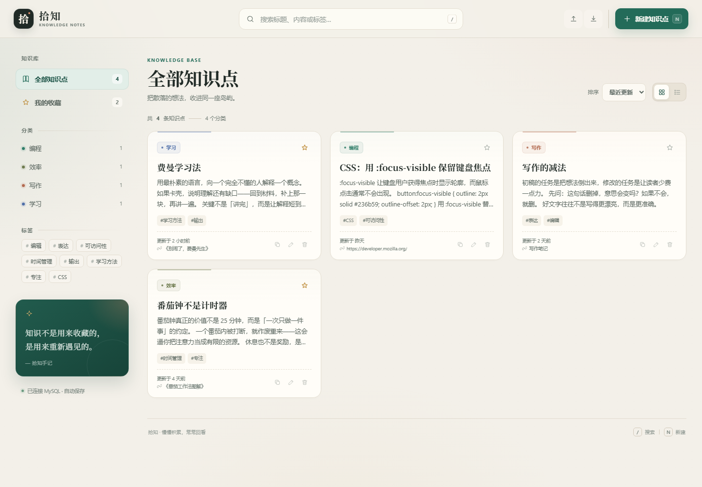
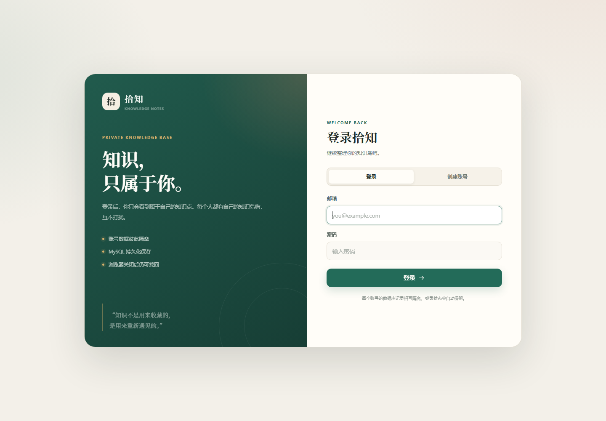
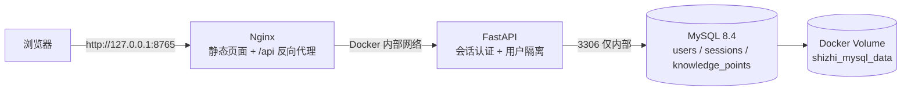

<div align="center">

# 拾知 · Shizhi

**把知识收进自己的岛屿。**

一个带多用户账号隔离的自托管知识点记录站：记录、分类、标签、搜索、收藏，一条 Docker 命令启动。

[](https://github.com/jaker-fk/shizhi/actions/workflows/ci.yml)
[](https://www.docker.com/)
[](https://fastapi.tiangolo.com/)
[](https://www.mysql.com/)
[](#账户与数据隔离)
[](LICENSE)
[](#contributing)
[](https://github.com/jaker-fk/shizhi/stargazers)
[](https://github.com/jaker-fk/shizhi/commits/main)



</div>

> A self-hosted knowledge notes app built with Docker, FastAPI and MySQL.  
> Record ideas, code snippets, reading notes and small discoveries — then find them again.

## 为什么是「拾知」

市面上的笔记工具很多，但真正影响长期使用的往往只有两件事：**记的时候够不够轻**，以及**找的时候够不够快**。

拾知围绕这两件事设计：

- **数据是你自己的**：知识点写入你自己的 MySQL，Docker 数据卷持久化，不依赖第三方云服务。
- **启动只要一条命令**：Web、API、数据库全部由 Docker Compose 编排，宿主机不需要安装 Node/Python。
- **为长期积累设计**：分类、标签、收藏、搜索、排序、卡片/列表双视图，记录越多越能体现价值。
- **安静、克制、响应式**：没有信息流和推送；桌面、平板、手机都能顺畅使用。

## 功能

| 能力 | 说明 |
| --- | --- |
| 👤 账户系统 | 邮箱注册、登录、退出；Argon2id 密码哈希 |
| 🔒 多用户隔离 | 每条知识点绑定 `owner_id`，所有 API 强制按当前用户过滤 |
| 🍪 安全会话 | 随机会话 token，数据库只存 SHA-256 哈希；HttpOnly + SameSite Cookie |
| ✍️ 记录与编辑 | 新建、编辑、删除知识点，删除后可在提示条中撤销 |
| 🗂 分类与标签 | 分类自由填写；标签用逗号分隔，侧栏自动汇总 |
| 🔎 搜索 | 搜索标题、正文、分类、标签和来源 |
| ⭐ 收藏 | 把值得反复回看的内容收进「我的收藏」 |
| ↕️ 排序与视图 | 最近更新 / 最近创建 / 标题排序；卡片 / 列表视图 |
| 💾 MySQL 持久化 | FastAPI 写入 MySQL 8.4，Docker 卷保存 |
| 📦 导入导出 | JSON 备份、合并导入；旧版 localStorage 数据自动迁移 |
| 📱 响应式 | 手机端编辑窗自动变为全屏表单 |
| ⌨️ 快捷键 | `/` 搜索、`N` 新建、`Ctrl/Cmd + Enter` 保存 |

## 账户与数据隔离

<p align="center">
  
</p>

- 密码使用 **Argon2id** 哈希，数据库不保存明文。
- 登录成功后生成随机会话 token，浏览器只保存 **HttpOnly + SameSite=Lax** Cookie，数据库只存 token 的 SHA-256 哈希。
- `knowledge_points.owner_id` 绑定用户；列表、读取、修改、删除、收藏、导入全部在服务端按当前用户过滤。
- 访问别人的知识点统一返回 `404`，不暴露记录是否存在。
- 写请求校验同源 `Origin`；认证接口按 IP 限速。
- 旧版单用户数据会在第一个账号注册时自动归属到该账号。

## 快速开始

需要 Docker Desktop，或 Docker Engine + Compose v2。

```bash
git clone https://github.com/jaker-fk/shizhi.git
cd shizhi

# 可选但推荐：修改数据库密码
cp .env.example .env

docker compose up -d --build
```

打开 **<http://127.0.0.1:8765/>**。

首次打开会进入登录页，点击「创建账号」注册第一个用户。之后所有知识点都只属于当前登录账号。

Windows 用户也可以直接双击 `start.bat`，脚本会检查 Docker、构建并启动全部服务。

首次启动需要拉取 MySQL 镜像并初始化数据库。确认服务状态：

```bash
docker compose ps
```

三个服务都显示 `healthy` 后即可使用。停止服务：

```bash
docker compose down
```

> `docker compose down -v` 会删除 MySQL 数据卷。除非明确要清空数据，否则不要加 `-v`。

### 页面提示「暂时连不上数据库」怎么办

先确认服务本身正常：

```bash
docker compose ps
curl http://127.0.0.1:8765/api/health
```

如果健康检查返回 `{"status":"ok","database":"mysql"}`，页面却仍报错，通常是浏览器还在使用**加入登录功能之前的旧 `app.js`**。旧脚本不知道 `/api/auth/me`，会直接请求需要登录的 `/api/knowledge`，得到 `401` 后误显示为数据库错误。

请按 **`Ctrl + F5`**（macOS 为 `Cmd + Shift + R`）强制刷新一次。新版已经给 HTML/JS/CSS 设置 `Cache-Control: no-cache`，并给资源加了版本参数，后续更新不会再被旧缓存卡住。

强制刷新后应看到登录页；首次使用点击「创建账号」即可。

## 技术架构



- 只有 Web 映射到宿主机 `127.0.0.1:8765`，API 与 MySQL 不暴露端口。
- API 与前端同源，通过 Nginx 的 `/api` 反向代理访问，无需配置 CORS。
- 数据库由 SQLAlchemy 初始化：`users` 保存账号，`sessions` 保存会话哈希，`knowledge_points.owner_id` 绑定数据归属。
- 所有知识点接口都要求登录，并在 SQL 查询中附带当前 `owner_id` 条件。

## 数据存在哪里

| 项目 | 位置 |
| --- | --- |
| 数据库 | `shizhi` |
| 账号表 | `users` |
| 会话表 | `sessions` |
| 知识表 | `knowledge_points`（通过 `owner_id` 归属用户） |
| Docker 卷 | `shizhi_mysql_data` |
| 容器内路径 | `/var/lib/mysql` |

查看数据：

```bash
docker compose exec mysql sh -c \
  'mysql -u"$MYSQL_USER" -p"$MYSQL_PASSWORD" "$MYSQL_DATABASE"'
```

```sql
SELECT id, title, category, favorite, updated_at
FROM knowledge_points
ORDER BY updated_at DESC;
```

### 备份与恢复

```bash
# 备份
docker compose exec -T mysql sh -c \
  'mysqldump -u"$MYSQL_USER" -p"$MYSQL_PASSWORD" --single-transaction --routines --triggers "$MYSQL_DATABASE"' \
  > shizhi-backup.sql

# 恢复
docker compose exec -T mysql sh -c \
  'mysql -u"$MYSQL_USER" -p"$MYSQL_PASSWORD" "$MYSQL_DATABASE"' \
  < shizhi-backup.sql
```

页面右上角也提供 JSON 导出/导入，适合做轻量备份或迁移。

## 适合谁

- 想要一个**不依赖云厂商**的个人知识库
- 正在学习编程、准备考试、做研究，需要整理概念和代码片段
- 喜欢用 Docker 托管自己服务的人
- 想和朋友、家人各自使用独立账号，但共享同一套服务的人
- 想在这个项目基础上继续做公开知识库的开发者

## 后续路线

- [x] 知识点 CRUD、搜索、分类、标签、收藏
- [x] MySQL 持久化与 Docker Compose 编排
- [x] JSON 导入导出、旧数据自动迁移
- [x] 用户登录、Argon2id 密码哈希、会话管理
- [x] 多用户数据隔离与跨站请求校验
- [x] 健康检查、响应式界面、快捷键
- [ ] 邮箱验证与密码找回
- [ ] 用户管理后台与账号注销
- [ ] Markdown 编辑与实时预览
- [ ] 服务端分页与全文检索
- [ ] PWA / 离线模式
- [ ] 公开演示站

如果你希望它变成公开注册的互联网服务，请继续阅读 [公网部署开发路线](docs/PUBLIC_DEPLOYMENT.md)。当前版本已经支持多账号隔离，但仍建议只在可信网络中使用；开放公网前还需要 HTTPS、邮箱验证、密码找回和更严格的限流策略。

## 开发与配置

<details>
<summary><strong>项目结构</strong></summary>

```text
.
├── index.html              # 页面结构、内联 SVG 图标
├── styles.css              # 视觉、布局与响应式
├── app.js                  # 交互、筛选、表单、导入导出
├── api.js                  # 前端 API 客户端
├── preview-auth.png        # 登录界面预览
├── Dockerfile              # Web 静态镜像（Nginx）
├── nginx.conf              # 静态站点与 /api 反向代理
├── docker-compose.yml      # web + api + mysql 编排
├── .env.example            # 环境变量模板
├── backend/
│   ├── app.py              # FastAPI 路由
│   ├── db.py               # MySQL 连接与初始化
│   ├── models.py           # 用户、会话、知识点模型
│   ├── schemas.py          # 请求校验
│   ├── security.py         # Argon2id、Cookie、会话 token
│   ├── requirements.txt
│   └── Dockerfile
├── docs/
│   └── PUBLIC_DEPLOYMENT.md # 公网化开发路线
├── .github/workflows/ci.yml # GitHub Actions 校验
├── start.bat               # Windows 一键启动
├── LICENSE                 # MIT License
└── README.md
```

</details>

<details>
<summary><strong>环境变量</strong></summary>

复制 `.env.example` 为 `.env` 后修改：

| 变量 | 默认值 | 说明 |
| --- | --- | --- |
| `MYSQL_DATABASE` | `shizhi` | 数据库名 |
| `MYSQL_USER` | `shizhi` | 应用数据库用户 |
| `MYSQL_PASSWORD` | `shizhi_dev_password` | 应用用户密码 |
| `MYSQL_ROOT_PASSWORD` | `shizhi_root_dev_password` | MySQL root 密码 |
| `SESSION_DAYS` | `14` | 登录会话有效天数（1–90） |
| `COOKIE_SECURE` | `false` | HTTPS 部署时设为 `true`，Cookie 只走加密连接 |
| `ALLOW_REGISTRATION` | `true` | 设为 `false` 可关闭公开注册；空库时仍允许创建第一个账号 |

`.env` 已被 `.gitignore` 和 `.dockerignore` 排除。公开部署前务必修改默认密码，并在 HTTPS 后设置 `COOKIE_SECURE=true`。

</details>

<details>
<summary><strong>API 一览</strong></summary>

| 方法 | 路径 | 作用 |
| --- | --- | --- |
| `GET` | `/api/health` | 健康检查（含数据库） |
| `POST` | `/api/auth/register` | 注册并建立会话 |
| `POST` | `/api/auth/login` | 登录 |
| `POST` | `/api/auth/logout` | 退出并清除会话 |
| `GET` | `/api/auth/me` | 当前登录用户 |
| `GET` | `/api/knowledge` | 获取当前用户的全部知识点 |
| `GET` | `/api/knowledge/{id}` | 获取单条 |
| `POST` | `/api/knowledge` | 新建 |
| `PUT` | `/api/knowledge/{id}` | 更新 |
| `PATCH` | `/api/knowledge/{id}/favorite` | 设置收藏 |
| `DELETE` | `/api/knowledge/{id}` | 删除 |
| `POST` | `/api/knowledge/import` | 合并导入 |

</details>

<details>
<summary><strong>从旧版本迁移</strong></summary>

旧版知识点保存在浏览器 `localStorage`（键名 `shizhi.knowledge.v1`）。新版首次连接空库时，会自动检测同一来源下的旧数据并导入。

如果自动迁移失败，或旧页面使用的是不同地址（`localhost` 与 `127.0.0.1` 属于不同站点），可在旧页面 Console 执行：

```js
copy(localStorage.getItem("shizhi.knowledge.v1"))
```

保存为 `.json` 文件后，在新页面点击导入。

</details>

## 快捷键

| 快捷键 | 作用 |
| --- | --- |
| `/` 或 `Ctrl/Cmd + K` | 聚焦搜索框 |
| `N` | 新建知识点 |
| `Ctrl/Cmd + Enter` | 在编辑窗中保存 |
| `Esc` | 关闭编辑窗 / 清空搜索 |

## Contributing

欢迎提交 Issue、功能建议和 Pull Request。

- 提交前请先确认 `docker compose config --quiet` 通过；
- 前端保持无构建步骤、无外部 CDN；
- 数据库相关改动请同时更新文档；
- 安全问题请优先通过 GitHub Security Advisories 私下报告，不要在公开 Issue 中贴出敏感信息。

如果这个项目对你有帮助，欢迎点一个 **Star** ⭐，这是对作者最直接的鼓励。

## License

本项目基于 [MIT License](LICENSE) 开源，可以自由使用、修改、分发和商用，但请保留原始版权声明。

## 说明

拾知目前已经支持邮箱账号、会话认证和多用户数据隔离，但仍是一个自托管起步版：注册开放，没有邮箱验证、密码找回、管理后台和审计系统。如果要部署到公网，请先完成 HTTPS、`COOKIE_SECURE=true`、邀请或邮箱验证、更严格的限流和备份恢复演练，路线见 [公网部署开发路线](docs/PUBLIC_DEPLOYMENT.md)。

---

<div align="center">

**知识不是用来收藏的，是用来重新遇见的。**

Made with care · FastAPI + MySQL + Docker

</div>
